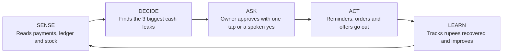
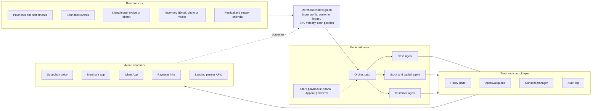

# Munim AI

**An agentic business partner for every store merchant: it watches the store's money and acts, with the owner's permission.**


> **Project status: work in progress.** This repository is our hackathon submission for Track 1 (Merchant Growth AI). The product design, architecture and pitch are complete; the prototype is under active development and runs on mock data. See [Project status](#project-status) for exactly what is done, in progress and planned.
>
> This is an independent hackathon project. It is not affiliated with or endorsed by Paytm.

---

## Table of contents

1. [Overview](#overview)
2. [The problem](#the-problem)
3. [Our solution](#our-solution)
4. [How a day with Munim works](#how-a-day-with-munim-works)
5. [Architecture](#architecture)
6. [Trust and control layer](#trust-and-control-layer)
7. [Store playbooks](#store-playbooks)
8. [Tech stack](#tech-stack)
9. [Project status](#project-status)
10. [Roadmap](#roadmap)
11. [Planned repository structure](#planned-repository-structure)
12. [Market context and sources](#market-context-and-sources)
13. [Assumptions and pilot targets](#assumptions-and-pilot-targets)
14. [Team](#team)

---

## Overview

Munim AI (a *munim* is the traditional accountant who keeps a shop's books) is an AI agent for store owners such as kirana shops and clothing stores. It watches payments, the credit ledger (*udhaar*) and stock, finds the biggest cash leaks, and prepares the next action. The owner approves with one tap or a spoken yes, and Munim carries it out.

**Positioning in one line:** a Soundbox tells the merchant what happened. Munim AI does something about it, within limits the merchant sets.

## The problem

Small stores rarely fail because of low sales. They leak cash in three places:

| Leak | What happens |
|---|---|
| **Cash stuck in udhaar** | Credit given to regular customers is hard to track and harder to recover. |
| **Cash stuck in the wrong stock** | Shelves are full but the wallet is empty. Fast movers run out while slow ones pile up. |
| **Regulars who quietly stop coming** | Nobody tells the owner which loyal customers have not visited in 60 days. |

The festive season makes this worse: credit demand tends to peak 30 to 45 days before sales do, so owners have to stock up before the cash arrives.

## Our solution

One brain with three loops, plus store-type playbooks.

- **Cash loop.** Tracks who owes what, sends polite reminders in the customer's language with a UPI pay link, and escalates only with the owner's approval.
- **Stock and capital loop.** Predicts what will run out or stall, drafts the distributor order, and shows a working-capital offer sized to the exact gap (with consent).
- **Customer loop.** Finds regulars who have gone quiet and drafts a win-back message with an offer the shop can afford.
- **Store playbooks.** The same brain runs different rules for Kirana, Apparel and General Retail.

### Why unified

Every store type leaks cash in the same three places. Only the rules differ, so we built one product with swappable playbooks instead of separate apps.

### Ideas borrowed from the other hackathon tracks

- From **Track 3 (Autonomous AI Teammates):** the agent takes actions and is measured on outcomes (rupees recovered, stock-outs avoided, regulars won back), not just answers.
- From **Track 2 (AI-Powered Financial Journeys):** a lending journey inside the stock loop, with a consent-first working-capital offer sized to the real gap.

## How a day with Munim works



Typical rhythm: morning brief, owner approval, actions during the day, evening summary.

**Illustrative scenario (not real data):** Meena Cloth Store in Palghar has about ₹1.8 lakh of udhaar across 24 customers, 6 festive items running low, and 31 regulars silent for 60+ days. Each morning Munim brings three one-tap decisions: approve reminders, review a restock order, and send a win-back offer.

## Architecture



**Five layers:**

1. **Data sources:** payments, settlements, Soundbox events, ledger entries, inventory and a festival calendar.
2. **Merchant context graph:** one structured view of the store: profile, customer ledger, SKU velocity and cash position.
3. **Munim brain:** an orchestrator that delegates to three specialist agents and loads the right store playbook.
4. **Trust and control layer:** sits between every decision and every action (details below).
5. **Action channels:** Soundbox voice, merchant app, WhatsApp, payment links and lending partner APIs.

A **learning loop** feeds outcomes back into the context graph so the next decision improves.

## Trust and control layer

Agentic systems that touch money must be safe by design. Nothing leaves Munim without passing through this layer.

- **Policy limits:** owner-set caps (for example, maximum reminders per customer per week, maximum order value per day).
- **Approval queue:** every outbound action is a draft the owner can approve, edit or skip.
- **Consent manager:** customer messaging and credit offers only with the required consent; no sharing of personal data beyond what the action needs.
- **Audit log:** an immutable record of what was proposed, what was approved and what was sent, with a plain-language "why this action".
- **Kill switch:** the owner can pause all automation at any time.

Because it is approval-first, Munim works with today's rails and does not depend on agent-payment protocols that are still being defined.

## Store playbooks

A playbook is a small configuration of rules that shapes how the same agents behave.

| | Kirana | Apparel |
|---|---|---|
| Typical ticket | Small, frequent | Larger, less frequent |
| Stock logic | Fast-moving staples, weekly distributor orders | Seasonal designs and sizes, festive stocking 8+ weeks early, dead-stock clearance |
| Udhaar pattern | Daily micro-credit to regulars | Larger, occasion-based credit |
| Customer loop | Replenishment reminders | Festive and new-arrival win-back |
| Capital loop | Short-cycle restocking gap | Pre-festive inventory buy |

General Retail is the extension path for new store types.

## Tech stack

| Layer | Choice | Why |
|---|---|---|
| Reasoning and language | Claude API with tool calling | Multilingual drafting and structured decisions |
| Forecasting | Python with LightGBM or Prophet | SKU velocity and festive demand |
| Backend | FastAPI, PostgreSQL, Redis queue | Ledger, background jobs and approvals |
| Voice | Open-source Indic speech-to-text and text-to-speech | Hindi and Marathi first |
| Frontend | React and Tailwind (PWA) | Merchant app that works on low-end phones |
| Channels | WhatsApp Business API, UPI payment links | Meets owners where they already are |
| Safety | Policy engine, consent store, immutable audit log | Trust by design |

The design is meant to plug into payments, settlement and Soundbox APIs and lending partner APIs. The prototype uses mock data and simulated integrations.

## Project status

| Area | Status |
|---|---|
| Problem research and product concept | Done |
| Architecture and trust-layer design | Done |
| Pitch deck | Done |
| Merchant app UI (prototype) | In progress |
| Agent logic (cash, stock and capital, customer) on mock data | In progress |
| Forecasting model on sample data | Planned |
| Voice and WhatsApp channels | Planned |
| Real payment, Soundbox and lender integrations | Planned (needs partner access) |

*Maintainers: update this table as work lands. Only mark an item "Done" when it is committed to this repository.*

## Roadmap

- **0 to 30 days:** working prototype on mock data; pilot with about 50 stores (kirana and apparel) in the Mumbai region.
- **30 to 90 days:** voice and WhatsApp channels, lender integration, owner-facing outcome dashboard.
- **90 days onward:** scale across an existing Soundbox base and add new store types.

## Planned repository structure

```text
munim-ai/
├── README.md
├── docs/                 # pitch deck, architecture diagrams
├── apps/
│   └── merchant-app/     # React + Tailwind PWA
├── services/
│   ├── api/              # FastAPI backend
│   ├── agents/           # orchestrator, cash, stock-capital, customer
│   ├── playbooks/        # kirana, apparel, general
│   └── trust/            # policy engine, consent, audit log
├── ml/                   # forecasting notebooks and models
└── data/mock/            # sample stores, ledgers and inventory
```

This is the intended layout and may change as the prototype evolves.

## Market context and sources

Facts used in our pitch, with sources:

- Paytm reports a merchant network of about 1.51 crore storefronts. [Paytm Blog](https://paytm.com/blog/payments/paytm-merchant-payments-network-1-51-crore-storefronts/)
- India has roughly 60 million merchants; about 20 to 25 million use a soundbox and 30 to 35 million still rely on printed QR codes. [Business Standard, 24 Sep 2026](https://www.business-standard.com/finance/news/fintechs-race-to-expand-merchant-networks-as-mdr-returns-to-upi-payments-126092401423_1.html)
- From 15 Oct 2026, a 0.4% MDR (capped at ₹300) applies to eligible UPI merchant payments above ₹2,000; small merchants receiving up to ₹1 lakh a month via UPI QR remain exempt. [Business Today, 15 Sep 2026](https://www.businesstoday.in/personal-finance/story/upi-mdr-rules-rs12-on-rs3000-rs200-on-rs50000-and-rs300-cap-on-rs75000-payments-check-faqs-555724-2026-09-15)
- Festive credit demand leads the sales calendar by about 30 to 45 days, and kirana and FMCG businesses are among the most sensitive. [Business Today, 23 Sep 2026](https://www.businesstoday.in/latest/economy/story/fmcg-kirana-garments-which-msme-sectors-are-seeking-the-most-festive-credit-557324-2026-09-23)
- Managing and recovering credit receivables is a major challenge for kirana retailers. [Redseer](https://redseer.com/articles/all-roads-lead-to-kirana/)

## Assumptions and pilot targets

These are **hypotheses to validate in a 60-day pilot, not measured results**:

- 20 to 30% of overdue udhaar recovered
- 15% fewer stock-outs on the top 20 items
- 10% of silent regulars won back

Revenue ideas under evaluation: a premium subscription on the merchant app, commission on working-capital loans from lending partners, payment-link and collection volume, and the retention value of more engaged merchants.

## Team

**Team Dev_With_Innovation** · Paytm Build for India AI Hackathon, Mumbai · Track 1: Merchant Growth AI

- Rishabh Shatrughan Jha (Team Lead)
- Raj Shukla
- Rajan Sonewane

St. John College of Engineering and Management, Palghar

## License

To be decided. Until a license is added, all rights are reserved by the authors.

